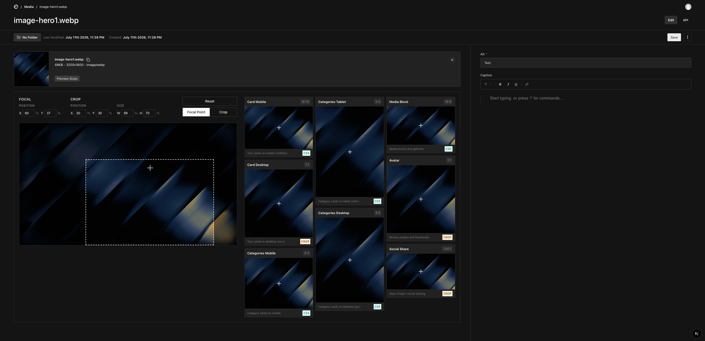
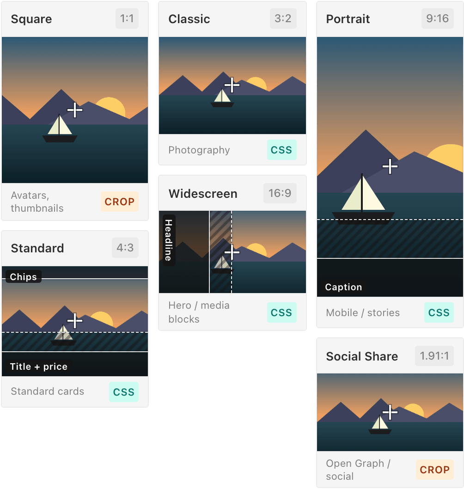

# Payload CMS Image Preview Plugin

[](https://www.npmjs.com/package/payload-plugin-aspect-preview)
[](./LICENSE.md)

**See how your photo fits before you save it.**

One photo might need to work in a wide hero, a square card, and a portrait mobile layout. **Image Preview for Payload CMS** lets editors check those formats side by side, adjust the crop or focal point, and watch every preview update as they edit.

`payload-plugin-aspect-preview` is a **Payload CMS plugin for image cropping, focal point editing, and responsive image previews**. It adds a live aspect ratio preview grid to upload collections, so editors can check several image formats on one screen in the Payload admin.



[Install the plugin](#installation) · [Configure your website's image formats](#preview-your-websites-image-formats)

## Help editors choose images that fit

A photo can look great in the media library and lose its subject when it fills a different shape on the website. Editors need to see what stays in the frame while they choose the image's crop and focal point.

- **Check several formats at once.** Compare hero, card, thumbnail, and mobile aspect ratios in a live preview grid.
- **Keep the subject in view.** Move the focal point and see how the framing changes across the configured ratios.
- **Crop with the result in sight.** Draw a crop while watching the previews on the same screen.
- **Preview new images before saving.** The editor appears as soon as you select an image, including on a new upload.
- **See what your text will cover.** Mark where a component puts a title, price, or badges over the photo, and editors keep the subject clear of it.
- **Use labels your editors recognize.** Configure formats such as “Homepage hero” or “Product card” with descriptions of where they are used.

Developers add the plugin to their upload collections and configure the ratios used by their frontend. Editors get the previews directly in Payload. Six common ratios are included to get started: square, 4:3, 3:2, 16:9, portrait 9:16, and a 1200 × 630 social share format.

## Installation

```bash
pnpm add payload-plugin-aspect-preview
```

## Quick start

```ts
import { buildConfig } from 'payload'
import { aspectPreviewPlugin } from 'payload-plugin-aspect-preview'

export default buildConfig({
  // ...
  plugins: [
    aspectPreviewPlugin({ collections: ['media'] }),
  ],
})
```

Your `media` collection must have uploads enabled. To use Payload's image processing and persist focal points, configure `sharp` in your Payload config, keep `focalPoint` enabled, and define `imageSizes` or `resizeOptions` on the collection. See [Payload's upload configuration](https://payloadcms.com/docs/upload/overview).

### For editors

1. Select a new image or open an existing image in the configured upload collection.
2. Move the focal point or draw a crop. Compare the live previews for your image formats.
3. Save the document when you are happy with the framing. Payload applies the image edits through its upload workflow.

## Preview your website's image formats

Give each preview the name of the component where the image will appear. Set its proportions to match your frontend:

```ts
aspectPreviewPlugin({
  collections: ['media'],
  aspectRatios: [
    { name: 'Homepage hero', ratio: '21:9', width: 21, height: 9, source: 'css', usage: 'Wide banner at the top of the homepage' },
    { name: 'Product card', ratio: '1:1', width: 1, height: 1, source: 'css', usage: 'Square images in the product grid' },
    { name: 'Mobile feature', ratio: '9:16', width: 9, height: 16, source: 'css', usage: 'Portrait image in the mobile layout' },
  ],
})
```

The previews simulate image framing using cover sizing and focal positioning. Configure the ratios yourself and use the saved focal point in your frontend's image positioning. The plugin previews the image inside each shape; it does not render your website's components or detect their styles automatically.

## Show where your site puts text over the image

If a component lays a title, price, or badges over the photo, editors can't see what that text will cover. Add `overlays` to a ratio and its preview shows those areas as bands along the frame's edges:

```ts
aspectPreviewPlugin({
  collections: ['media'],
  aspectRatios: [
    {
      name: 'Product card',
      ratio: '4:3',
      width: 4,
      height: 3,
      usage: 'Title and price over the bottom of the photo',
      overlays: [
        { label: 'Badges', edge: 'top', min: 0.12 },
        { label: 'Title + price', edge: 'bottom', min: 0.22, max: 0.4 },
      ],
    },
    {
      name: 'Hero',
      ratio: '16:9',
      width: 16,
      height: 9,
      overlays: [{ label: 'Headline', edge: 'left', min: 0.35, max: 0.5 }],
    },
  ],
})
```



- `min` is the share of the frame the component always covers. It is drawn as a solid band.
- `max` is the share it covers at worst, such as a title that wraps to three lines. The stretch from `min` to `max` is hatched and ends in a dashed line. Leave `max` out when the area has a fixed size.
- Both are fractions from 0 to 1 of the frame's height (`top`, `bottom`) or width (`left`, `right`). Measure them on your component at the size editors care about most.

The bands are fixed to the frame, so they stay in place while the image moves under them as you change the focal point or crop. They don't block the editor and follow Payload's light and dark themes. Ratios without `overlays` look exactly as before.

The plugin checks overlays when Payload loads its config. An invalid entry (an unknown `edge`, a fraction outside 0–1, or `max` below `min`) stops startup with an error that names the ratio and the overlay.

## Configuration

| Option | Type | Required | Default | Description |
|---|---|---|---|---|
| `collections` | `string[]` | yes | — | Upload collection slugs to enhance. |
| `aspectRatios` | `AspectRatioConfig[]` | no | `DEFAULT_ASPECT_RATIOS` | Ratios shown in the preview grid. |
| `disabled` | `boolean` | no | `false` | Keep the schema field but disable the upload override. |

### `AspectRatioConfig`

| Field | Type | Required | Description |
|---|---|---|---|
| `name` | `string` | yes | Display label (e.g. `"Social Share"`). |
| `ratio` | `string` | yes | Display token (e.g. `"16:9"`). |
| `width` | `number` | yes | Ratio numerator (or absolute px width). |
| `height` | `number` | yes | Ratio denominator (or absolute px height). |
| `source` | `'css' \| 'crop'` | no | Display badge describing the intended use. Does not change image processing. |
| `usage` | `string` | no | Description shown in the card footer. |
| `category` | `string` | no | Optional metadata label. Does not group cards in the current UI. |
| `overlays` | `AspectRatioOverlay[]` | no | Areas your frontend covers with text or UI, drawn over the preview. See [Show where your site puts text over the image](#show-where-your-site-puts-text-over-the-image). |

### `AspectRatioOverlay`

| Field | Type | Required | Description |
|---|---|---|---|
| `label` | `string` | yes | Shown inside the band (e.g. `"Title + price"`). |
| `edge` | `'top' \| 'bottom' \| 'left' \| 'right'` | yes | The frame edge the covered area starts from. |
| `min` | `number` | yes | Fraction (0–1) of the frame always covered. Height for `top`/`bottom`, width for `left`/`right`. |
| `max` | `number` | no | Fraction (0–1, at least `min`) covered at worst. Defaults to `min`. |

## Examples

**Multiple collections**

```ts
aspectPreviewPlugin({ collections: ['media', 'avatars'] })
```

**Disable without dropping the schema**

```ts
aspectPreviewPlugin({ collections: ['media'], disabled: true })
```

## How it works

The plugin replaces the configured collections' upload UI with `CustomUpload` and adds an `aspectPreview` UI field rendered by `FocalPointEditor`. Crop and focal point edits flow through Payload's upload-edits context. Payload applies the crop on save and persists focal coordinates as `focalX` and `focalY`.

The preview grid uses cover sizing equivalent to `object-fit: cover` and `object-position` based on the focal point. When a crop is active, the grid previews that crop region with the focal point measured relative to it.

## Frequently asked questions

### When should I use this plugin?

`payload-plugin-aspect-preview` adds live previews of multiple aspect ratios to Payload upload collections. Use it when one image needs to fit several formats, such as hero banners, product cards, thumbnails, and portrait mobile images. Configure `aspectPreviewPlugin` with your collection slugs and the ratios your frontend uses.

### How does it differ from Payload's built-in crop and focal point tools?

Payload already supports image cropping, focal points, and generated image size previews. This plugin brings crop and focal point editing together with a preview grid that updates as you edit. Its preview ratios can represent your frontend's image containers, even when you do not generate separate files for those ratios.

### Does it generate a separate crop for each preview?

No. The grid shows how one shared crop and focal point fit different aspect ratios. Adding a preview does not create a new image size. Configure generated image sizes through Payload's `imageSizes` option.

### Is this a full page live preview?

It previews image framing inside the media editor. Use Payload's page live preview for the rest of your layout, text, and components.

### Will the previews match my website?

They model cover sizing with focal positioning at your configured aspect ratios. Your frontend must use the corresponding ratios and saved focal coordinates. Different fit modes, additional crops, or image processing can change the result. Text your components place over the image is shown only where you describe it with `overlays`.

## Requirements and compatibility

- Payload and `@payloadcms/ui` `^3.85.0`
- React `^19.0.0`
- Node.js `>=20.9.0`

The replacement upload UI uses `@payloadcms/ui` internals (`FileDetails`, `Dropzone`, `PreviewSizes`, …). These are not a stable public API, so a Payload minor upgrade may require a plugin update. Pin your Payload version and test after upgrades.

## License

MIT © Sebastian Kolbusz
